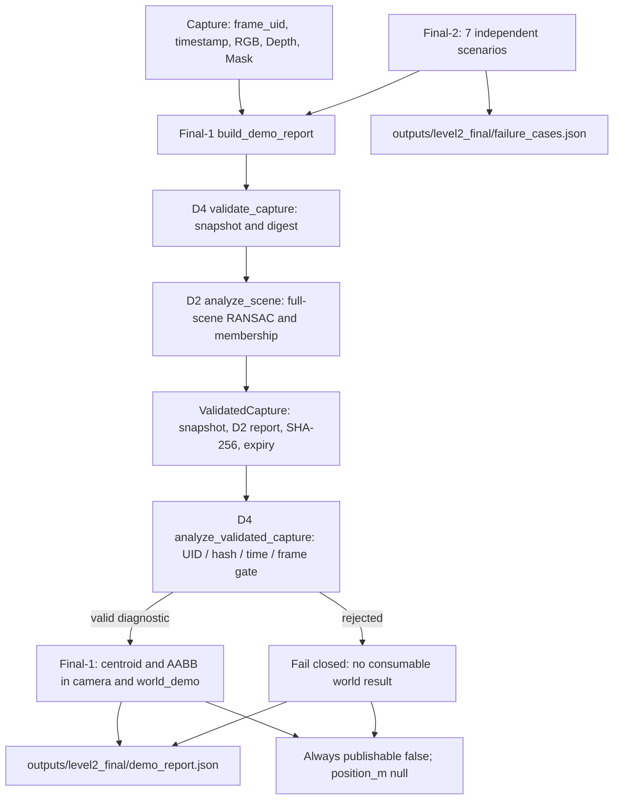

# Level 2 最终综合 Boss｜RGB-D Object Localizer 工程交付记录

> 项目：`Project_002_RGBD_Object_Localizer`（P02）  
> Learning Unit：`Level2-Final`；范围为 **3D 位置合成基线**，不是 6D Pose / T1 80 分  
> 前置：OS-01-A/B/C/D 均 COMPLETE；D 闭环 Commit `78b57fdfdbb4b80408a5e84cbcce5d973b09b726`  
> 当前验收：理论 / 预测 / 主动实验 / 故障注入 / Boss **PASS**；Final 文档及 Git/GitHub **待闭环**  
> 实测：Windows，Python 3.11.17，Open3D 0.20.0，pytest 9.1.1  
> 实际本机全仓回归：**742 passed, 106 subtests passed in 3.42s**（2026-10-29）  
> 本笔记不声称物理精度、真实外参、可信票据或机器人执行许可。

## 1. 目标、知识地图、产物和验收

**目标**：把已经通过的 OS-01-A～D 合成诊断链变成单入口可复现、可审计、具有明确坐标系和安全边界的工程交付。不是再开发一套分割、RANSAC 或 SE(3) 算法。

**知识链**：相机内参 → Mask×Depth → XYZ 反投影 → Open3D 背景分割 / 目标归属 → 同帧快照 → 质心 / AABB → 合成 SE(3) → 状态与失败审计 → Git/GitHub。

**本关产物**：

- `configs/level2_final_cases.json`：7 个固定的预期状态与故障场景。
- `src/pipeline/os01_final1_demo_report.py`：从 D4 的验证快照生成相机 / `world_demo` 几何报告。
- `src/pipeline/os01_final2_failure_audit.py`：针对 Final-1 运行 7 个审计场景。
- `tests/test_os01_final1_demo_report.py` / `tests/test_os01_final2_failure_audit.py`：各 5 项测试。
- `outputs/level2_final/demo_report.json` / `failure_cases.json`：本机实测生成的诊断记录（必须在提交前审查）。
- `figures/level2_coordinate_chain.svg`：3D 坐标语义、数据流与安全边界图。
- 本笔记和 README 更新，以及最后一次 `Git Commit → GitHub Push → SHA 对齐`。

## 2. 真实代码调用顺序和接口边界

> 概念图写成 `RGB-D → D2 → D4 → Final-1 → Final-2` 可以表达学习层次，但不是实际调用栈。



- D2 用整个场景点云拟合 `Z=2.0 m` 的主背景平面，再根据合成目标 Mask 检查被保留点的逐点身份、XYZ 和 RGB。`DIAGNOSTIC_ONLY` **不是**物理真值声明。
- D4 的 `validate_capture()` **内部调用 D2** 并保存防御性快照、`frame_uid`、时间、哈希、D2 诊断。`ValidatedCapture` **没有签名**、没有独立认证机构，且 `frozen=True` 不代表内部 NumPy 数组真正不可变。
- D4 的 `analyze_validated_capture()` 在上游状态、时效、UID、内容和外参方向检查通过后，只处理已验证快照；错误输入不得被继续反投影。
- Final-1 使用 D4 的结果再计算两坐标系 AABB / 质心，检查两条质心计算路径一致性；其报告路径是 `outputs/level2_final/demo_report.json`。
- Final-2 **不是 Final-1 的单一输出拼接器**；它独立调用 Final-1 7 次并审计预期状态，写出 `outputs/level2_final/failure_cases.json`。
- 拒绝路径的最终世界系质心和 AABB 应为 `null`；任何路径 `position_m=null`、`publishable=false`、`physical_accuracy_claimed=false`。

## 3. Final-1：最小公式、主动预测与实际结果

D2 合成场景（80×100 像素）：目标 `u=30..69`、`v=20..59`，其中内部 `u=40..49`、`v=30..39` 的 100 个深度失效。相机内参 `fx=fy=100 px`, `cx=49.5 px`, `cy=39.5 px`，目标深度 `Z=1.2 m`。

有效目标点数 `1600 - 100 = 1500`。因内部缺失区域偏左上，剩余像素的均值比原来向正 `u/v` 各偏移 `1/3 px`：

\[
\bar{X}=\frac{(\bar{u}-c_x)Z}{f_x}=0.004\,\mathrm m,\quad
\bar{Y}=0.004\,\mathrm m,\quad \bar Z=1.2\,\mathrm m.
\]

AABB 定义为各轴 `min` / `max`，而不是点集的均值；内部缺失没有删除外围极值：

\[
\operatorname{extent}_c=[(69-30)\tfrac{1.2}{100},\,(59-20)\tfrac{1.2}{100},\,0]
=[0.468,0.468,0]\,\mathrm m.
\]

合成外参：

\[
R_{wc}=\begin{bmatrix}0&-1&0\\1&0&0\\0&0&1\end{bmatrix},\qquad
 t_{wc}=[0.10,-0.20,0.30]^T\,\mathrm m.
\]

由 `P_world_demo = R_wc @ P_camera + t_wc`：

| 诊断量 | 实际本机输出（浮点误差忽略） | 单位 |
| --- | --- | --- |
| 目标有效点数 | 1500 | 点 |
| 相机质心 | `[0.004, 0.004, 1.2]` | m |
| `world_demo` 质心 | `[0.096, -0.196, 1.5]` | m |
| 相机 AABB Extent | `[0.468, 0.468, 0]` | m |
| `world_demo` AABB Extent | `[0.468, 0.468, 0]` | m |
| 受控发布位置 / 授权 | `null` / `false` | - |

**主动预测 / 迁移验证**：

1. 仅平移点云，`max + t - (min + t)`，所以 AABB Extent 不变。
2. 旋转一般会改变 AABB Extent；本例 90° 绕 Z 转动且 X/Y 原始跨度相同，因此数值恰好不变。
3. 45° 绕 Z 旋转，四个角点仍在当前有效点云中，X/Y Extent 各约 `0.468×√2 = 0.66185 m`；不能直接沿用未旋转的 Extent。
4. 若仅把所有有效深度从 `1.2 m` 改为 `2.4 m`、像素布局与内参不变，X/Y Extent 线性增至 `[0.936,0.936] m`（Z Extent 仍为 0）。
5. 质心受全部有效点权重影响，AABB 中心只受轴向极值影响。本例相机质心 `[0.004,0.004,1.2]`，AABB 中心 `[0,0,1.2]`；二者不相同。

**已通过的 Final-1 自动测试**：同帧质心/AABB、安全字段；帧 B 不得复用 A；逆外参拒绝；数量正确但身份错误的拒绝；非轴对齐旋转下 AABB 变化，**5 passed**。

## 4. Final-2：7 个可追溯场景与失败审计

| 场景 | 预期与本机观测的状态 | 结论 |
| --- | --- | --- |
| baseline | `DIAGNOSTIC_ONLY` | 仅诊断 |
| different_frame_uid | `FRAME_UID_MISMATCH` | 拒绝 |
| modified_depth_same_uid | `INPUT_DATA_HASH_MISMATCH` | 拒绝 |
| expired_validation | `STALE_VALIDATION_TICKET` | 拒绝 |
| swapped_target_background_equal_counts | `UPSTREAM_REJECTED` | 拒绝 |
| inverse_transform | `FRAME_MISMATCH` | 拒绝 |
| calibration_claim_true | `DIAGNOSTIC_ONLY` | 仅诊断 |

**运行前预测**：诊断 2、拒绝 5、允许发布 0。**实测**：`Cases: 7`，`Diagnostic only: 2`，`Rejected: 5`，`All cases passed: True`，`Physical accuracy claimed: False`，预期与实测一致。

配置约束测试覆盖重复 ID、场景缺失、预期状态漂移、配置 SHA-256 变化及全案例 Fail-closed；**5 passed**。

## 5. 最终 Boss 五项验收、纠正与迁移

### Boss 1：解释 / 数据生命周期（PASS）

能解释从采集、D2 场景分割、D4 同帧绑定、Final-1 几何诊断到 Final-2 多场景审计的职责。纠正：Final-1 调用 D4，再由 D4 调用 D2；`DIAGNOSTIC_ONLY` 不等于发布授权。

### Boss 2：预测 / 几何推导（PASS）

正确回答质心/AABB 中心差异、平移不改变范围、45° 旋转约 `[0.6619,0.6619,0] m`、深度加倍约 `[0.936,0.936,0] m`。纠正：缺失的是目标内部 10×10 区域，不是边缘像素。

### Boss 3：排错 / 拒绝路径（PASS）

- `FRAME_UID_MISMATCH`：D4 消费帧的 UID 与验证快照 UID 不同，拒绝反投影与世界坐标；优先查 snapshot / candidate 的 UID、时间与哈希。
- `INPUT_DATA_HASH_MISMATCH`：候选帧内容与验证快照的整体哈希不同，拒绝消费；当前项目没有 `rgb_sha256` 等三个独立票据字段。
- `FRAME_MISMATCH`：本关实际由 `RigidTransform.source_frame_id / target_frame_id` 与预期 `camera_optical_frame → world_demo` 不一致触发；不是仅仅比较 estimate/GT 的 frame ID。
- 所有拒绝路径保留 `status`、`reasons` 等安全诊断，不暴露可消费的世界系坐标，统一 `position_m=null`、`publishable=false`。

### Boss 4：统计 / 证据口径（PASS）

OS-01-C：20 个不同的合成输入；8 个几何通过（40%）；6 个具有合法参考值且可以评估（30%）；Mean `2.2361 mm`、P95 `2.4820 mm`，均**只用这 6 个可评估样本**计算。14 个不可评估样本应该单独报告拒绝原因，不能当作误差为 0；把不可评估样本随意填入分位数可能导致任意偏差，不应声称统计更有代表性。

正确名称：`synthetic_nominal_reference_discrepancy_mm`；不能称之为工业测量的 P95 物理定位精度。需要独立物理参考、真实深度、可审查标定、帧/时间匹配、空间覆盖、异常分析与不确定度评估。

### Boss 5：迁移 / 正确坐标语义（PASS）

目前**只有** `camera_optical_frame → world_demo` 合成刚体变换及一个目标中心点 `P_world_demo`，不具有已估计的 `object_frame`。目标中心点不是 6D Pose。生产级 6D Pose 还需物体坐标系定义、方向、姿态歧义与旋转误差评估。

未来若引入已标定的 `robot_base`，可写成：

\[
P_{base}=T_{base\leftarrow camera}\,P_{camera},\qquad
P_{world}=T_{world\leftarrow base}\,P_{base}.
\]

这里两式表示**未来需要构建的可信坐标链**，不是当前代码已实现的真实标定。单个 `P_world` 只是 world 下的一个点，不能当作 `T_world_from_object`。

**交付文件及命令**见下一节。用户草稿中的 `src.pipeline.os01_final_demo`、`src.experiments.os01_d_open3d_compare`、`results/os01` 与当前仓库代码不符，已在本笔记纠正。

## 6. 最小复现指令（Windows PowerShell）

在仓库根目录、已配置的 `ai_3d` 环境中执行，确认每一步退出码为 0：

```powershell
# 切换到已安装依赖的 ai_3d 环境；仓库根目录执行
python --version
python -c "import open3d, numpy, pytest; print('Open3D',open3d.__version__,'NumPy',numpy.__version__,'pytest',pytest.__version__)"

# Final-1 单入口及 Final-2 七案例
python -m src.pipeline.os01_final1_demo_report
python -m src.pipeline.os01_final2_failure_audit

# 分别运行专项与全仓回归
python -m pytest tests/test_os01_final1_demo_report.py -v
python -m pytest tests/test_os01_final2_failure_audit.py -v
python -m pytest -q

# 检查最终报告（先看内容再决定是否加入 Git）
Get-Content .\outputs\level2_final\demo_report.json -Encoding UTF8
Get-Content .\outputs\level2_final\failure_cases.json -Encoding UTF8
```

**已观测证据**：Final-1 `5 passed in 0.38s`；Final-2 `5 passed in 0.51s`；全仓 `742 passed, 106 subtests passed in 3.42s`；`git diff --check` 无输出。该最后一项**不覆盖未暂存文件**，提交前还要 `git diff --cached --check`。

**环境复现缺口**：最新 GitHub 树中没有 `requirements.txt` 或 `environment.yml`。当前材料证明用户的已有 Windows/Conda 环境中可运行，不等于全新机器上已经重复验证了依赖安装。需要后续收集经人工审核的最低依赖、版本锁定与干净环境复现记录；本次不得宣称已经完成。

## 7. 数据来源、可追溯性与安全界限

- 数据：EXP028 确定性合成 RGB-D，目标 1,500 个有效点；背景 6,400 点。目标 Mask 是合成标签而非独立物理真值。
- 相机内参：`fx=fy=100 px`, `cx=49.5 px`, `cy=39.5 px`；深度单位 m，输出 XYZ / AABB 单位 m，Round-trip `roundtrip_residual_mm` 单位 mm。
- 外参：`demo_transform()` 是 `camera_optical_frame → world_demo` 人工旋转和平移，没有可信物理标定。
- 输入绑定：SHA-256 是**完整性检测**而非签名；无可信授予方，不能当作可防恶意篡改的票据。
- 位置口径：`centroid_world_demo_m` 是可视化/诊断；`position_m` 是受控发布接口，本阶段一律 `null`。
- 物理准确性：`physical_accuracy_claimed=false`。不可对外宣称“物理精度 P95 = 2.4820 mm”。
- 受控发布：`publishable=false`。真实机器人控制仍需独立规划、碰撞检查、安全策略和外部互锁。**严禁将演示坐标接入机器人执行系统。**

## 8. 完成判定与 Git 闭环

| SOP 条件 | 当前证据 | 状态 |
| --- | --- | --- |
| 理论/公式/参数解释 | Boss 1–5、AABB/SE(3)/SHA-256 | PASS |
| 主动修改 + 先预测后验证 | D1 体素 5→20 mm；D2/D3/D4 故障注入；Final-1/2 预测 | PASS |
| 最小工程/自主排错 | D1–D4 + Final-1/2 测试、状态契约 | PASS |
| ≥20 样本的合成基线 | OS-01-C 20 个样本，Mean/Median/P95/Max | PASS（synthetic only） |
| 可复现演示 + 失败审计 | 2 个 JSON、7 固定案例、742 tests | PASS（本机） |
| 交付笔记 / README / 坐标图 | 本次生成 | 待入库 |
| Git commit + GitHub push + SHA 一致 | 尚无 Final 阶段提交证据 | **PENDING** |
| 外部干净环境与物理准确性 | 无可信独立实测 | 不在本合成基线声称范围内 |
| T1 80 分：≥50 帧与 6D Pose | 本阶段尚未做 | NOT CLAIMED |

**当前结论：`Level 2 · CONTINUE`，直到 Final 文件审查、Commit、Push 和 `HEAD == origin/master` 验证成功。** 不因为测试通过就提前宣布 `LEVEL COMPLETE`。
